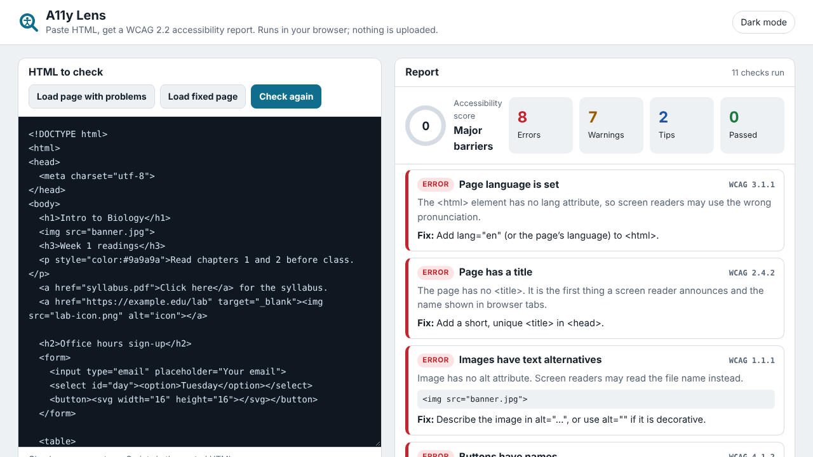

# Juilee Giramkar — Web Portfolio

**Live site: https://juileegiramkar.github.io/web_portfolio/**

Portfolio of web and teaching-technology projects, hand-coded in plain HTML, CSS and JavaScript. No frameworks, no build step.

## Projects

| Project | Live demo | What it does |
|---|---|---|
| **A11y Lens** | [Open app](https://juileegiramkar.github.io/web_portfolio/projects/a11y-lens/index.html) | Paste HTML and get an accessibility report. Runs 11 WCAG 2.2 checks (alt text, form labels, heading order, link text, contrast, captions and more) and shows a score and a fix for each problem. |
| **Teaching Commons** | [Live site](https://juileegiramkar.github.io/web_portfolio/projects/teaching-commons/index.html) | Responsive faculty resource website with search, topic and format filters with live counts, sorting, a workshop list and a mobile menu. Uses sample content. |
| **Bloom's Taxonomy Explorer** | [Try it](https://juileegiramkar.github.io/web_portfolio/projects/blooms-explorer/index.html) | Interactive SVG pyramid of the six levels of thinking, with verbs, activities and assessments for each, plus a builder that writes learning objectives and flags vague wording. |
| **Color Contrast Checker** | [On the home page](https://juileegiramkar.github.io/web_portfolio/#demo) | Checks any two colors against WCAG AA and AAA, using the W3C luminance formula. |



## Built with

- HTML5 with semantic structure and ARIA where needed
- CSS: Grid, Flexbox, custom properties, light and dark themes
- Vanilla JavaScript: DOM APIs, `DOMParser`, SVG

## Accessibility

Every page supports the keyboard, shows a visible focus outline, respects reduced-motion settings, comes in light and dark themes, and fits phone-width screens without sideways scrolling.

## Project structure

```
index.html                  Portfolio home page (includes the contrast checker)
projects/a11y-lens/         Accessibility checker
projects/teaching-commons/  Faculty resource site
projects/blooms-explorer/   Bloom's Taxonomy explorer
screenshots/                Project thumbnails
```

## Run locally

Clone the repo and open `index.html` in any browser.

## Contact

[GitHub](https://github.com/juileegiramkar)
